# Lircay Trail

> Prototipo funcional para **LircayHub** · Producto de Software 2 · Programación de Dispositivos Móviles 2026-02 · Universidad de Talca

Lircay Trail es una app de senderismo pensada para la Reserva Nacional Altos de Lircay (Región del Maule). Te acompaña mientras caminas: te avisa por **vibración** y por **voz** cuándo doblar, la puedes controlar hablándole, te manda avisos importantes y tiene un botón **SOS** para pedir ayuda. Todo está pensado para funcionar **sin conexión**, porque en la montaña no se puede contar con señal.

En el PDS1 entregué una maqueta. En el PDS2 la convertí en un **prototipo funcional**. Esto fue lo que hice:

- Reorganicé la app con arquitectura **MVVM** e inyección de dependencias (Provider).
- Integré el riesgo técnico de la PoC (**mapa sin conexión**) en una capa de servicios.
- Agregué **persistencia** de ajustes, contactos e historial de caminatas.
- Conecté la app con el sistema operativo mediante el selector nativo de compartir (**interoperabilidad**).
- Construí un módulo de **Beta Testing** dentro de la app, con un instrumento en JSON.
- Definí la identidad nativa del paquete (`cl.lircayhub.lircaytrail`, ícono y splash).

## Capturas

| Lista de senderos | Detalle del sendero | Caminata activa |
|---|---|---|
| 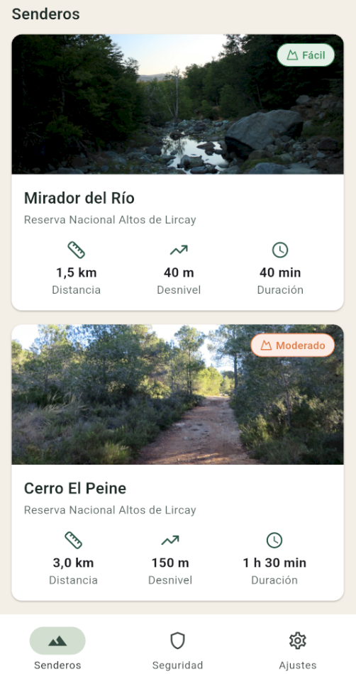 | 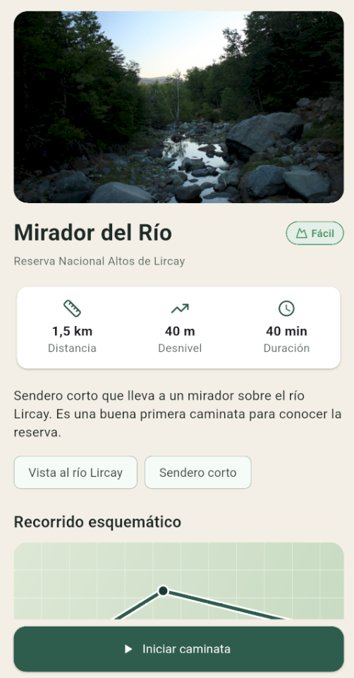 | 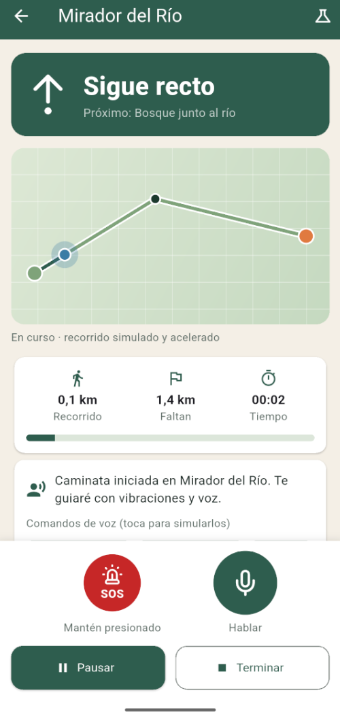 |

| SOS enviado | Aviso de caída | Resumen |
|---|---|---|
| 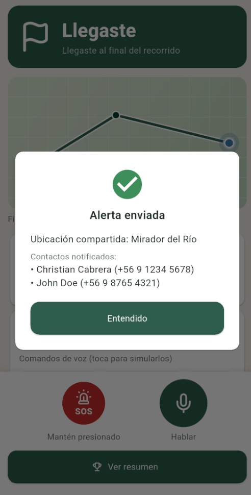 | 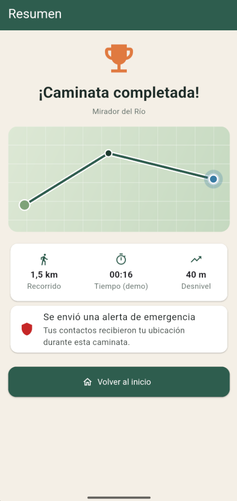 | 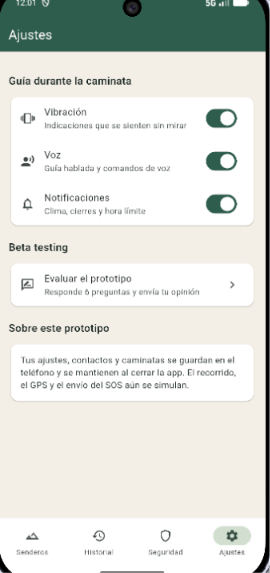 |

| Historial | Evaluación (Beta) | Mapa sin conexión |
|---|---|---|
| 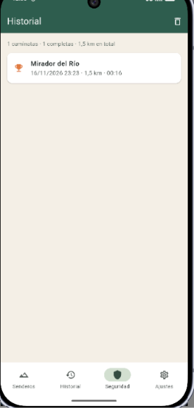 | 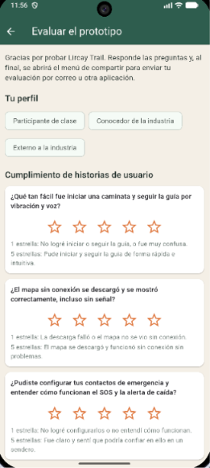 | 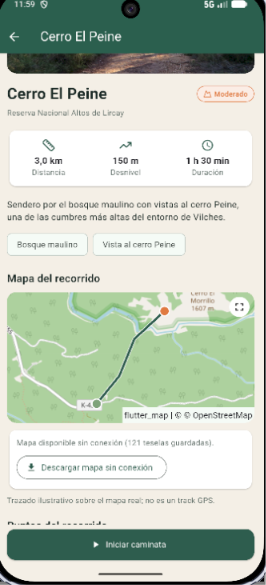 |


## Índice

1. [Definición del producto](#1-definición-del-producto)
2. [Especificación de requerimientos](#2-especificación-de-requerimientos)
3. [Arquitectura: MVVM e inyección de dependencias](#3-arquitectura-mvvm-e-inyección-de-dependencias)
4. [ADR de la PoC: mapa sin conexión](#4-adr-de-la-poc-mapa-sin-conexión)
5. [Persistencia de datos](#5-persistencia-de-datos)
6. [Beta Testing y reporte de QA](#6-beta-testing-y-reporte-de-qa)
7. [Despliegue y APK](#7-despliegue-y-apk)
8. [Material de apoyo](#8-material-de-apoyo)
9. [Deuda técnica y trabajos futuros](#9-deuda-técnica-y-trabajos-futuros)

---

## 1. Definición del producto

### El problema

Altos de Lircay es la mayor área protegida de la región, con unas 16.700 hectáreas, y recibe visitantes todo el año. Las caminatas son largas: el Mirador del Venado ronda los 11,7 km y el Enladrillado unos 12 km. En ese terreno se juntan tres cosas que complican todo. Primero, no se puede asumir que haya señal. Segundo, uno camina con bastones, guantes o mochila y casi nunca tiene una mano libre para el celular. Tercero, si algo sale mal (una torcedura, una caída, perderse en una bifurcación) la ayuda queda lejos. Las apps de mapas normales exigen mirar la pantalla todo el tiempo, dependen de internet y no avisan a nadie si te pasa algo.

### La solución

Lircay Trail resuelve eso con una guía que se **siente y se escucha** en vez de solo verse. Cada indicación (seguir recto, girar a la izquierda, girar a la derecha, te saliste del sendero, llegaste) tiene su propio patrón de vibración y su propia frase hablada. Además puedes pedirle cosas por voz ("¿cuánto falta?", "pausa", "auxilio"), recibes avisos de clima o de hora límite de regreso, y si necesitas ayuda mantienes presionado el botón SOS. Si la app detecta una posible caída te pregunta si estás bien y, si no respondes en 10 segundos, envía la alerta sola.

### Por qué tiene que ser una app móvil

El problema ocurre en terreno, de pie, caminando, y ahí el teléfono aporta lo que un computador no puede: va en el bolsillo, tiene motor de vibración, micrófono, parlante, sensores y notificaciones.

| Capacidad del celular | Para qué la uso | Estado en el prototipo |
|---|---|---|
| Vibración | Indicaciones de giro que se sienten sin mirar | Real |
| Parlante (texto a voz) | Frases como "gira a la izquierda en la bifurcación" | Real |
| Micrófono (voz a texto) | Comandos manos libres | Real |
| Mapa con caché local | Ver el mapa de la zona sin señal | Real (servicio de la PoC) |
| Selector nativo de compartir | Enviar la evaluación Beta por correo u otra app | Real |
| Notificaciones | Avisos de clima, camping y hora límite | Simulado dentro de la app |
| Acelerómetro | Detectar una caída | Simulado desde el menú de demo |
| GPS y envío de alertas | Ubicación del SOS y envío a contactos | Simulado |

### Por qué Flutter

Elegí Flutter porque con un solo código puedo apuntar a Android e iOS, porque el hot reload me permitió iterar rápido, y porque la composición por widgets me sirvió para reutilizar piezas. Además existen plugins maduros para el hardware que necesito (`vibration`, `flutter_tts`, `speech_to_text`).

### Qué es real y qué es simulado

Lo que depende del hardware del teléfono y validé en la PoC o en el PDS1 es real: vibración, voz, reconocimiento de comandos, caché del mapa, persistencia y compartir. Lo que dependería de infraestructura (GPS, envío real del SOS, clima) lo sigo simulando. El recorrido es una demo acelerada: cada tramo dura 8 segundos reales y el menú de demo (ícono del matraz) permite provocar un desvío, una caída, un aviso de clima o la hora límite.

---

## 2. Especificación de requerimientos

### Historias de usuario

El rol principal es el **senderista**.

- **HU-01.** Como senderista, quiero ver una lista de senderos de Altos de Lircay con su foto, dificultad, distancia y desnivel, para elegir una ruta acorde a mi nivel.
- **HU-02.** Como senderista, quiero abrir el detalle de un sendero, para conocer su descripción, sus puntos y un esquema del trayecto antes de decidir.
- **HU-03.** Como senderista, quiero probar las indicaciones de vibración y voz antes de salir, para entender cómo me va a guiar la app.
- **HU-04.** Como senderista, quiero recibir las indicaciones de giro por vibración y por voz durante la caminata, para guiarme sin sacar el teléfono ni mirar la pantalla.
- **HU-05.** Como senderista, quiero activar un SOS manteniendo presionado un botón, para avisar a mis contactos con mi ubicación si tengo una emergencia.
- **HU-06.** Como senderista, quiero que la app detecte una posible caída y me pregunte si estoy bien, para que se pida ayuda aunque yo no pueda hacerlo.
- **HU-07.** Como senderista, quiero controlar la app con la voz ("cuánto falta", "pausa", "dónde estoy"), para usarla con guantes o con las manos ocupadas.
- **HU-08.** Como senderista, quiero recibir avisos de clima, camping y hora límite de regreso, para planificar mi vuelta con seguridad.
- **HU-09.** Como senderista, quiero ver un resumen al terminar la caminata, para revisar cuánto recorrí y si hubo alguna alerta.

### Requerimientos funcionales

| ID | Requerimiento | Historia | Dónde se ve en el código |
|---|---|---|---|
| RF-01 | Listar senderos con foto, dificultad, distancia, desnivel y duración | HU-01 | `home_screen.dart`, `home_view_model.dart`, `trail_card.dart` |
| RF-02 | Navegar de la lista al detalle del sendero seleccionado | HU-02 | `home_screen.dart`, `trail_detail_screen.dart` |
| RF-03 | Mostrar descripción, puntos del recorrido y esquema del trayecto | HU-02 | `trail_detail_screen.dart`, `trail_map_preview.dart` |
| RF-04 | Probar cada indicación (vibración y voz) antes de salir | HU-03 | `haptic_service.dart`, `voice_service.dart` |
| RF-05 | Iniciar una caminata simulada que avanza punto a punto | HU-04 | `active_hike_view_model.dart` |
| RF-06 | Disparar en cada punto la indicación (texto, vibración y voz) | HU-04 | `nav_cue.dart`, `nav_cue_banner.dart` |
| RF-07 | SOS por presión sostenida de 2 segundos | HU-05 | `sos_button.dart`, `active_hike_screen.dart` |
| RF-08 | Detección de caída (simulada) con cuenta regresiva de 10 segundos | HU-06 | `active_hike_view_model.dart` |
| RF-09 | Comandos de voz: cuánto falta, dónde estoy, repite, pausa, continuar, terminar y auxilio | HU-07 | `voice_service.dart`, `active_hike_view_model.dart` |
| RF-10 | Mostrar avisos de clima, camping y hora límite, con vibración | HU-08 | `notification_service.dart`, `alert_tile.dart` |
| RF-11 | Pausar, reanudar y terminar la caminata, y mostrar un resumen | HU-09 | `hike_control_bar.dart`, `hike_summary_screen.dart` |
| RF-12 | Administrar contactos de emergencia y hora límite de regreso | HU-05, HU-08 | `safety_screen.dart`, `safety_view_model.dart` |
| RF-13 | Activar o desactivar vibración, voz y notificaciones | HU-03 | `settings_screen.dart`, `settings_view_model.dart` |
| RF-14 | Mapa con descarga de zonas y lectura sin conexión | HU-02, HU-04 | `offline_map_service.dart`, `offline_map_download_tile.dart` |
| RF-15 | Guardar cada caminata terminada y mostrar el historial | HU-09 | `hike_history_repository.dart`, `history_view_model.dart` |
| RF-16 | Evaluación Beta dentro de la app a partir de un JSON, con envío por el selector de compartir | (QA) | `qa_instrument.json`, `qa_view_model.dart`, `share_service.dart` |

### Requerimientos no funcionales

| ID | Requerimiento | Cómo se cumple |
|---|---|---|
| RNF-01 | Funcionar sin conexión | Datos de senderos locales, caché de teselas con FMTC y persistencia local |
| RNF-02 | Arquitectura desacoplada | MVVM: las vistas solo dibujan y los ViewModels consumen repositorios y servicios |
| RNF-03 | Identidad visual centralizada | `ThemeData` global, `AppColors`, `AppTextStyles` y tipografía Nunito |
| RNF-04 | Lista eficiente | `SliverList.builder` y fotos con `cacheWidth` limitado |
| RNF-05 | Usable en terreno | Botones grandes y acciones críticas con presión sostenida |
| RNF-06 | Respaldo no visual | Cada indicación importante llega también por vibración y por voz |
| RNF-07 | Robustez ante fallos del entorno | Cada servicio captura errores (permisos denegados, sin red, almacenamiento) y degrada sin cerrar la app |
| RNF-08 | Persistencia entre sesiones | Ajustes, contactos, historial y evaluaciones sobreviven al reinicio de la app |
| RNF-09 | Plataforma | Android (iOS no probado) |
| RNF-10 | Control de versiones | Git con `.gitignore`, ramas `feature/*` y APK publicado en GitHub Releases |

---

## 3. Arquitectura: MVVM e inyección de dependencias

### Estructura de carpetas

```
lib/
├── main.dart                      # arranque, composición de dependencias y providers
├── core/
│   ├── constants/                 # rutas de assets
│   ├── data/
│   │   └── mock_data.dart         # senderos de ejemplo (fuente de TrailRepository)
│   ├── enums/                     # dificultad, indicación, vibración, estado, tipo de aviso
│   ├── repositories/              # acceso a datos (abstracción + implementación)
│   │   ├── trail_repository.dart  # abstracto + MockTrailRepository
│   │   ├── settings_repository.dart
│   │   ├── hike_history_repository.dart
│   │   └── qa_repository.dart
│   ├── services/                  # hardware y sistema operativo
│   │   ├── haptic_service.dart
│   │   ├── voice_service.dart
│   │   ├── notification_service.dart
│   │   ├── offline_map_service.dart   # servicio de la PoC
│   │   └── share_service.dart         # Intent nativo (share_plus)
│   └── utils/
├── models/                        # Trail, Waypoint, HikeSession, HikeRecord, UserSettings, QaInstrument...
└── ui/
    ├── screens/                   # Views: solo dibujan y delegan
    ├── viewmodels/                # ChangeNotifier con la lógica de presentación
    ├── widgets/
    └── theme/

assets/
├── font/   icons/   images/
└── qa/qa_instrument.json          # instrumento de evaluación Beta
```

La regla que me puse es que las dependencias van en una sola dirección: **View → ViewModel → Repository/Service → fuente de datos**. Ninguna View accede a un repositorio o servicio de datos, y nada de `core` ni de `models` importa algo de `ui`.

### Diagrama MVVM

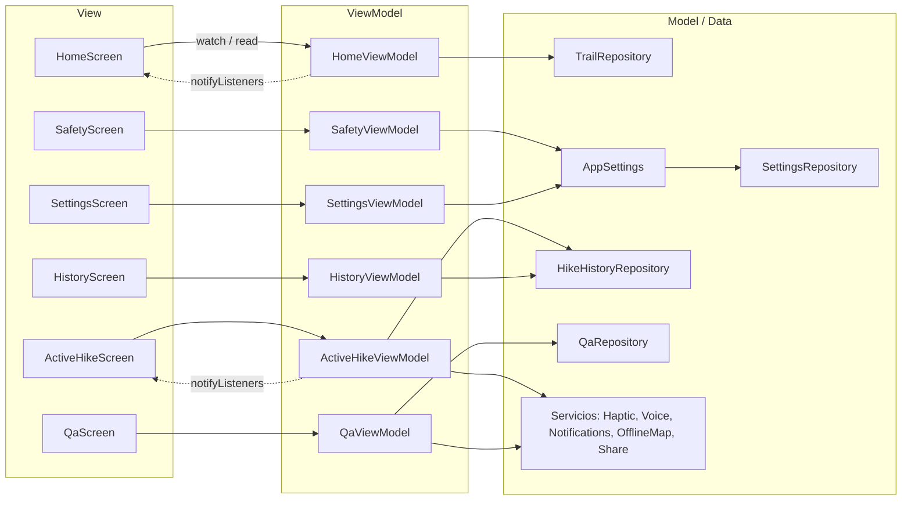

Cada View se suscribe al estado de su ViewModel con `context.watch` (o `Consumer`/`Selector` para reconstruir solo lo necesario) y le envía las acciones del usuario con `context.read`. Los ViewModels notifican con `notifyListeners()`; las Views no tienen lógica de negocio ni `setState` para estado del dominio.

### Inyección de dependencias

Construyo las dependencias **una sola vez** en `main()` y las expongo con `MultiProvider`. Los ViewModels las reciben por constructor, así que no conocen implementaciones concretas y puedo reemplazarlas por dobles en las pruebas.

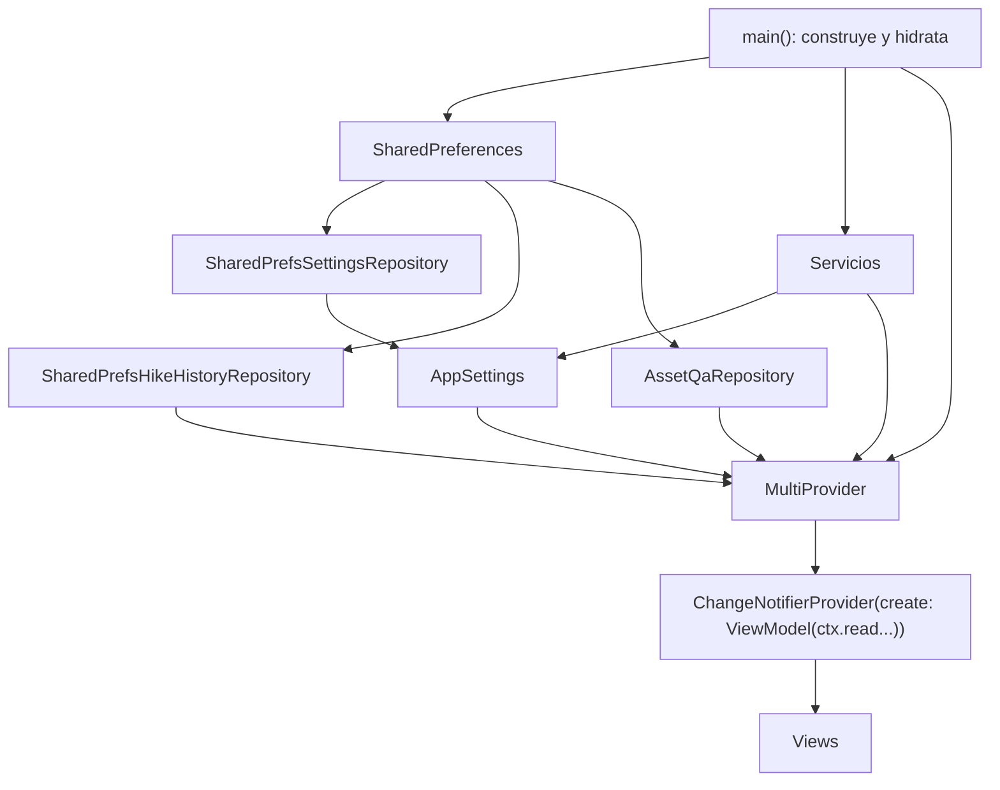

```dart
// main.dart: composición
final prefs = await SharedPreferences.getInstance();
final settings = AppSettings(
  haptic: haptic, voice: voice, notifications: notifications,
  repository: SharedPrefsSettingsRepository(prefs),
);
await settings.load(); // hidrata antes de runApp

// active_hike_screen.dart: el ViewModel nace con sus dependencias
ChangeNotifierProvider(
  create: (ctx) => ActiveHikeViewModel(
    trail: trail,
    haptic: ctx.read<HapticService>(),
    voice: ctx.read<VoiceService>(),
    notifications: ctx.read<NotificationService>(),
    history: ctx.read<HikeHistoryRepository>(),
    settings: ctx.read<AppSettings>(),
  ),
  child: const _ActiveHikeView(),
);
```

### Jerarquía de navegación

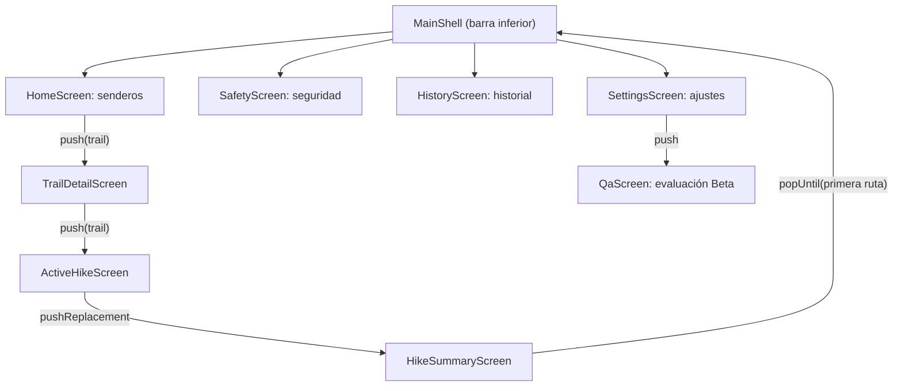

---

## 4. ADR de la PoC: mapa sin conexión

**Estado:** aceptada e integrada · **Fecha de la PoC:** DP2

### Contexto (riesgo evaluado)

Mi app se usa en zonas donde la señal móvil es intermitente o nula. El riesgo técnico crítico que identifiqué es que un mapa estándar depende de una conexión constante para pedir teselas, lo que rompería la experiencia justo donde más se necesita.

### Alternativas consideradas

| Alternativa | Ventaja | Por qué no |
|---|---|---|
| Google Maps SDK | Familiar y completo | Requiere clave comercial y su soporte de mapas sin conexión es limitado y no controlable desde la app |
| Teselas empaquetadas en `assets/` | Funciona siempre | Aumenta mucho el tamaño del APK y no se puede actualizar la zona |
| **`flutter_map` + `flutter_map_tile_caching` (FMTC)** | Open source, sin claves, control de la descarga y lectura local | **Elegida** |

### Decisión

Adopté `flutter_map` con `flutter_map_tile_caching`, que guarda las teselas en el almacenamiento interno del teléfono mediante una base local (ObjectBox, dependencia interna de FMTC). Me permite descargar una zona con conexión y leerla después sin señal, con control total de la descarga.

### Resultados de la PoC

- Comprobé que es posible descargar y renderizar una zona del mapa sin conexión con un consumo bajo de memoria.
- Verifiqué que los fallos esperables (sin red, almacenamiento lleno) se capturan como excepciones y no cierran la app.

### Consecuencias e integración

**No fusioné** el código descartable de la PoC a la rama principal. Lo refactoricé en una capa de servicios:

- `OfflineMapService` inicializa el caché, descarga zonas y expone un estado observable. Si la inicialización falla, la app usa el mapa esquemático en lugar de cerrarse.
- `OfflineMapDownloadTile` es una vista que solo dibuja el estado y delega la acción.
- El servicio se crea en `main()` y se inyecta con Provider, como el resto de las dependencias.

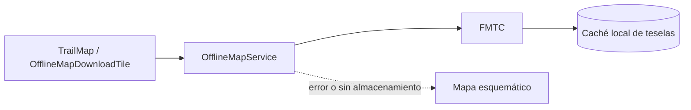

**Pendiente que asumo:** el reconocimiento de voz de varios teléfonos necesita internet, lo que contradice la idea de funcionar sin señal. Los chips de comandos de la pantalla son el respaldo.

---

## 5. Persistencia de datos

| Dato | Mecanismo | Repositorio | Cuándo se carga |
|---|---|---|---|
| Ajustes (vibración, voz, notificaciones, caída, hora límite) | `shared_preferences` (JSON) | `SettingsRepository` | `settings.load()` antes de `runApp` |
| Contactos de emergencia | `shared_preferences` (JSON, dentro de los ajustes) | `SettingsRepository` | Igual que los ajustes |
| Historial de caminatas (últimas 50) | `shared_preferences` (lista de JSON) | `HikeHistoryRepository` | Al abrir la pestaña Historial |
| Evaluaciones Beta enviadas (comprobante local) | `shared_preferences` (lista de JSON) | `QaRepository` | Al abrir la evaluación |
| Zonas de mapa descargadas | Caché de FMTC | `OfflineMapService` | Al iniciar la app |

Si un dato guardado está corrupto, el repositorio lo ignora y parte con valores por defecto sin cerrar la app.

---

## 6. Beta Testing y reporte de QA

### Instrumento

Diseñé `assets/qa/qa_instrument.json` con 6 preguntas en escala de 1 a 5 estrellas, que la app lee y dibuja:

| Ámbito | Preguntas |
|---|---|
| `cumplimiento_hu` | HU-01 (iniciar caminata y seguir la guía), HU-02 (mapa sin conexión), HU-03 (contactos, SOS y caída) |
| `usabilidad` | UX-01 (navegación y claridad), UX-02 (persistencia al reabrir), UX-03 (contenido y utilidad) |

Cada evaluación también registra el **perfil** del usuario y un comentario opcional. Al enviar, la app guarda un comprobante local y abre el **selector nativo de compartir** con un reporte legible y el mismo contenido en JSON, que guardo como evidencia.

### Muestra

| Perfil | Requerido | Evaluaciones recibidas |
|---|---|---|
| Participantes de Workspace Mobile Firsts | 4 | `2` |
| Conocedores de la industria | 3 | `3` |
| Externos a la industria | 3 | `3` |
| **Total** | **10** | `8` |

### Resultados

> Promedio por pregunta y por perfil, calculado solo con las evaluaciones reales recibidas.

| Pregunta | Promedio general |
|---|---|
| HU-01 | `5.00` |
| HU-02 | `3.33` |
| HU-03 | `5.00` |
| UX-01 | `4.33` |
| UX-02 | `5.00` |
| UX-03 | `4.33` |

### Qué funcionó

- La facilidad para entender para qué sirve la app, la simplicidad del diseño, la persistencia entre sesiones.

### Qué falló

| Hallazgo | Detectado por | Estado |
|---|---|---|
| Las pestañas **Seguridad** e **Historial** mostraban el contenido cruzado | `Conocedor y participante` | `Pendiente` |
| El mapa sin conexión no funcionó para un tester (HU-02 con 1/5) | Conocedor de la industria | `Pendiente` |
| No se entiende para qué sirve la campana de la pantalla de inicio | Participante | Pendiente (ver deuda técnica) |

### Trabajos futuros (deuda técnica)

Ver [sección 9](#9-deuda-técnica-y-trabajos-futuros).

### Evidencia

Los reportes enviados por los usuarios (texto y JSON) se guardan como evidencia en el Outlook`.

---

## 7. Despliegue y APK

### Requisitos

- Flutter con Dart `^3.13`.
- Android Studio o VS Code con las extensiones de Flutter y Dart.
- Un teléfono Android real, de preferencia: el emulador no vibra y el micrófono suele dar problemas.

### Ejecutar desde el código

```bash
git clone https://github.com/Condordie/Lircayhub
cd Lircayhub
flutter pub get
flutter analyze
flutter run
```

### Permisos en `AndroidManifest.xml`

```xml
<uses-permission android:name="android.permission.INTERNET"/>
<uses-permission android:name="android.permission.VIBRATE"/>
<uses-permission android:name="android.permission.RECORD_AUDIO"/>
<queries>
  <intent><action android:name="android.intent.action.TTS_SERVICE"/></intent>
  <intent><action android:name="android.speech.RecognitionService"/></intent>
  <intent>
    <action android:name="android.intent.action.SEND"/>
    <data android:mimeType="text/plain"/>
  </intent>
</queries>
```

### Generar el APK

```bash
flutter build apk --release
# Resultado: build/app/outputs/flutter-apk/app-release.apk
```

### Identidad del paquete

| Elemento | Valor |
|---|---|
| Package name (`applicationId`) | `cl.lircayhub.lircaytrail` |
| Nombre visible | Lircay Trail |
| Ícono y splash | Generados con `flutter_launcher_icons` y `flutter_native_splash` (`dart run flutter_launcher_icons`, `dart run flutter_native_splash:create`) |

### Descarga

**APK instalable:** `https://github.com/Condordie/Lircayhub/build/app/outputs/flutter-apk/app-debug.apk`

Para instalarlo en Android hay que permitir la instalación desde orígenes desconocidos.

### Flujo de trabajo en Git

- Trabajo sobre la rama `main` y desarrollo cada funcionalidad nueva en una rama `feature/*`, que integro por Pull Request.
- Mi `.gitignore` excluye `build/` y los binarios; publico el APK solo en **GitHub Releases**, asociado a un tag.

### Si algo falla

| Síntoma | Qué revisar |
|---|---|
| `Unable to load asset` | Que las carpetas estén declaradas en `pubspec.yaml` y reiniciar la app por completo |
| El mapa no carga en el APK release | Que el permiso `INTERNET` esté en el manifiesto |
| No abre el menú de compartir | Que la consulta `SEND` esté en `<queries>` |
| No vibra | Probar en un teléfono físico |
| La voz no responde | Permiso de micrófono concedido y conexión a internet |

---

## 8. Material de apoyo

- **Video del pitch y Diapositivas del Pitch:** `https://drive.google.com/drive/folders/15wBzXl_NZ7i4znypJZMn7ZGE_AR2r0jR?usp=sharing`
- **Repositorio:** https://github.com/Condordie/Lircayhub


## 9. Deuda técnica y trabajos futuros

- **Notificaciones, GPS, acelerómetro y envío real del SOS** siguen simulados. Me falta integrar `flutter_local_notifications`, `geolocator`, `sensors_plus` y el envío por SMS o llamada con `url_launcher`.
- **Persistencia:** `shared_preferences` me alcanza para el volumen actual, pero un historial grande o con consultas pediría una base local (por ejemplo SQLite o Isar).
- **Voz sin conexión:** el reconocimiento de voz suele necesitar internet; me falta evaluar un reconocimiento local.
- **Cifras provisorias de senderos:** tengo que verificarlas con CONAF o Andeshandbook (todos los senderos salvo el Mirador del Venado y El Enladrillado).
- **Campana de la pantalla de inicio:** no queda claro su propósito; voy a agregar una etiqueta o explicación, o a quitarla.
- **Rutas:** quiero centralizar la navegación (por ejemplo con `go_router`).
- **Pruebas automáticas:** todavía no escribí pruebas de widgets ni unitarias de los ViewModels; la inyección por constructor me facilita agregarlas.
- **Archivos largos:** `ActiveHikeViewModel` y `active_hike_screen.dart` podría dividirlos.